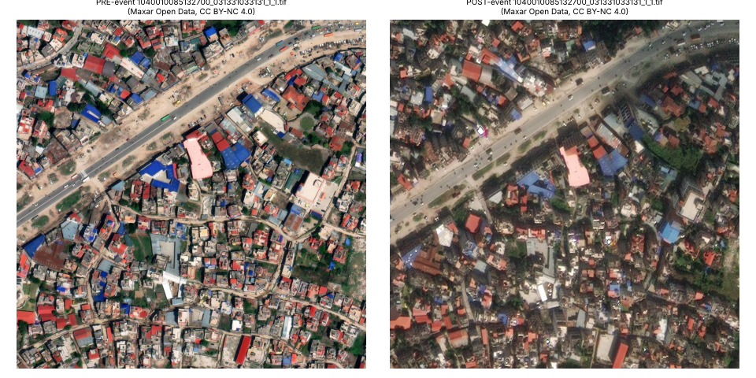

# Labelling guide: flooded roads and buildings on Nepal 2024 Maxar tiles (S4)

Imagery: Maxar Open Data, CC BY-NC 4.0, academic use only. Credit "Maxar Open Data Program" on
every figure.

## What exists

`python scripts/maxar_nepal.py list` (November 2026) found 533 items in the
`Nepal-Floods-Sept-2024` collection. The only post-event images are GeoEye-1, **6 October 2024**,
over the **Kathmandu Valley** (Bagmati, Nakhu and Hanumante rivers flooded on 27-28 September in
the same storm as the Koshi floods). The Koshi-area images are all pre-event. So Level 2 is tested
on Kathmandu Valley tiles; the radar replay (Level 1) stays on Koshi/Madhesh. The post images are
nine days after the peak: much of the water had gone, so flood evidence is often mud, debris and
wet ground rather than open water. Label what you can see, and mark the rest "unclear".

## Steps

1. `python scripts/maxar_nepal.py pairs` then `tiles --max-pairs 60` (tiles near the rivers come
   first when flood polygons for the valley are saved in `$DATA_ROOT/nepal/unosat/`).
2. `python scripts/maxar_nepal.py osm` writes one GeoJSON per tile in
   `$DATA_ROOT/nepal/maxar/tiles/labels/` with OSM roads and buildings, the SpaceNet 8
   attribute names and an empty `flooded` field.
3. In QGIS: load the PRE-event and POST-event tile and the tile's GeoJSON. Toggle between pre and
   post. For each road segment and building set `flooded`:
   - `yes`: flooded in the post image (rules below)
   - `no`: clearly dry
   - `unclear`: cloud, shadow, haze, image edge, or you cannot tell
   Split a road segment where its status changes (Vertex tool, "Split Features").
4. Add roads or buildings OSM missed only if they are clearly visible in the pre image; copy the
   attributes of a similar feature and set `id` to `manual/<n>`.
5. Save, then (sn8 env) `python scripts/nepal_level2.py prepare`,
   `python -m src.level2_roads.evaluate --config configs/S4.yaml --split nepal_maxar_labelled`,
   and (flood env) `python scripts/nepal_level2.py compare`.

## When is a road "flooded"?

A road segment is `yes` when, in the post image, any part of its carriageway is:

- under water (brown or grey water surface, reflections, no road markings visible), or
- covered by fresh mud or flood debris that was not there in the pre image (the sign that water
  went over it, the usual case nine days after the peak), or
- cut: washed out, collapsed, or the bridge deck is missing or damaged.

Not flooded (`no`): wet but intact asphalt with markings visible; mud only on the shoulder; a
river that is high but below the road level.

A building is `yes` when water or a fresh mud line reaches its walls, or it is surrounded by
debris; `no` otherwise.

## Clouds, haze and unclear cases

- Cloud or thick haze over the feature: `unclear`. The road status engine treats these segments as
  "unknown" (never as dry).
- Shadow of a tall building over the road: decide from the visible ends; if both ends differ or
  are hidden, `unclear`.
- Image misregistration (pre and post shifted): judge on the post image alone.
- Doubt between `yes` and `no`: choose `unclear`. Missing a flooded road is the costly error, but a
  wrong `yes` label also breaks the evaluation. `unclear` segments are left out of precision and
  recall and counted separately.

## Quality check

Label 5 tiles twice on different days and compare: if more than 1 in 10 segments changed, reread
these rules and relabel. Note the time per tile; expect 10 to 20 minutes.
