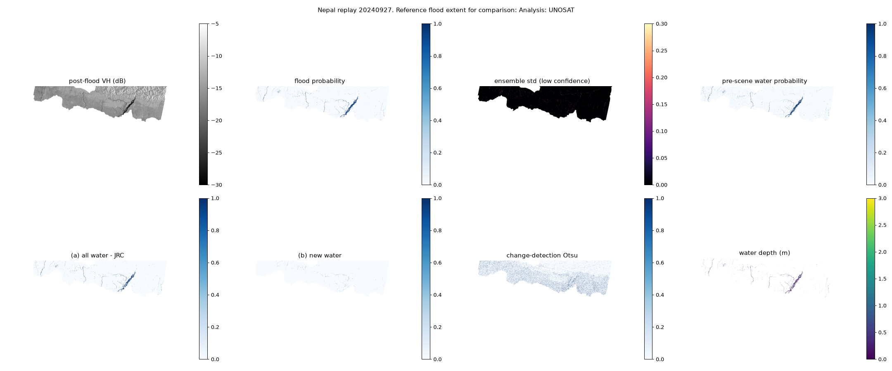
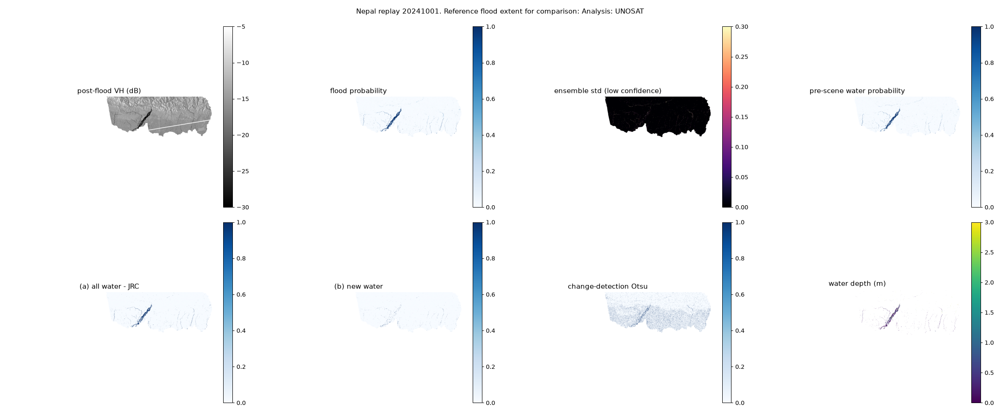

# Nepal replay, Level 1 (Koshi floods, September to October 2024)

Generated by `python scripts/nepal_level1.py run`. Each of our Sentinel-1 scenes is
compared with the UNOSAT flood extent of the same date (product FL20240928NPL),
inside UNOSAT's analysis extent of that date. Permanent water (JRC occurrence >= 50 %) is left out of the analysed area for every map,
UNOSAT's included: the product has no permanent-water layer of its own.

**Analysis: UNOSAT** (United Nations Satellite Centre, FL20240928NPL, preliminary, not
field-validated). Contains modified Copernicus Sentinel data [2024].

## Two versions of our flood map

- **(a) All water minus JRC.** The E6 ensemble finds every pixel of open water on the
  post date; water JRC saw in at least 50 % of its observations is removed.
- **(b) New water.** The same ensemble also runs on the pre-flood scene of the same
  relative orbit (`S1_<post date>_pre.tif`, the latest acquisition in 2024-09-01 to 2024-09-20),
  and flood is water in the post scene that is not water in the pre scene. JRC
  permanent water is removed as in (a). (b) is the map used for exposure and priority
  (`configs/priority.yaml`), so the normal river channel does not count as exposed.

UNOSAT's layers are "New Water / Water Increase" against **its own reference image,
Sentinel-1 of 11 June 2024**, which is not part of the product. Our pre scenes are from
**mid-September 2024**, deep in the monsoon, when much more of the floodplain is already
wet. Water that appeared between June and mid-September counts as new for UNOSAT but
not for (b), so **(b) may under-count relative to UNOSAT**; (a) over-counts because it
keeps all seasonal water. The two bracket UNOSAT's definition.

## Seasonal water: why (a) disagrees with UNOSAT

Area that (a) marks as flood but UNOSAT does not, inside the analysis extent, split
by JRC water occurrence (km^2):

| Date | False flood | JRC never water (0) | JRC rare (1-9) | JRC seasonal (10-49) |
|---|---|---|---|---|
| 2024-09-27 | 137.8 | 39.5 | 23.6 | 74.7 |
| 2024-10-01 | 112.2 | 26.7 | 18.2 | 67.3 |

Most of it is water JRC has seen before, the larger part seasonal (occurrence 10 to
49 %): the braided Koshi channels, sand bars and floodplain ponds that are wet every
monsoon. JRC >= 50 % does not remove them, but UNOSAT's June 2024 reference does.
(a)'s recall is high, so the extra area is mostly a difference of definition, not
missed detections; (b) removes water already present in mid-September.

## New water (b): low recall against UNOSAT

| Date | UNOSAT km^2 | (a) km^2 | (a) recall | (b) km^2 | (b) recall | (b) precision |
|---|---|---|---|---|---|---|
| 2024-09-27 | 50.14 | 179.92 | 0.8401 | 29.07 | 0.1161 | 0.2002 |
| 2024-10-01 | 49.43 | 158.89 | 0.9433 | 35.2 | 0.1989 | 0.2793 |

(b) removes nearly all of (a)'s seasonal false flood (see its false-flood split in
`docs/results/nepal_level1_<date>.json`), but it also loses most of UNOSAT's flood:
the gap between (a)'s and (b)'s recall is UNOSAT flood that our model already saw as
water in the mid-September pre scene. This is the expected direction (UNOSAT's
reference is June 2024, ours is mid-September), but the size is large: by this
comparison, most of what UNOSAT reports as new water was already wet before
27 September. (b) therefore under-counts flood relative to UNOSAT, and exposure
computed from (b) under-counts accordingly. Precision does not rise with (b): most of
its new water is not in UNOSAT's layer either (open these places in QGIS; candidates
are wet soil, new sand bars and changes between orbits).

## 2024-09-27

Scene `S1_20240927.tif`; UNOSAT layers `S1_20240927_FloodExtent_Koshi_Madhesh.shp` and `S1_20240927_AnalysisExtent_Koshi_Madhesh.shp` (acquired 00:11 UTC).

### Inside UNOSAT analysis extent of the same date, inside our scene

Analysed area 7945.6 km^2; UNOSAT flood inside it 50.14 km^2 (53.2 km^2 before removing permanent water).

| Method | Flooded km^2 | IoU | F1 | Precision | Recall |
|---|---|---|---|---|---|
| (a) E6 ensemble, all water minus JRC >= 50 % | 179.92 | 0.224 | 0.3661 | 0.234 | 0.8401 |
| (b) E6 ensemble, new water (post and not pre) | 29.07 | 0.0793 | 0.147 | 0.2002 | 0.1161 |
| Change-detection Otsu | 788.4 | 0.0233 | 0.0455 | 0.0242 | 0.3804 |
| Single-date Otsu (VH) | 1557.34 | 0.0303 | 0.0588 | 0.0303 | 0.9423 |

### Inside the same, clipped to Nepal (the extent polygons also cover India)

Analysed area 7930.3 km^2; UNOSAT flood inside it 50.02 km^2 (53.07 km^2 before removing permanent water).
UNOSAT's own table for this date: analysed 6139 km^2, flood 41.06 km^2, about 17,317 people exposed.

| Method | Flooded km^2 | IoU | F1 | Precision | Recall |
|---|---|---|---|---|---|
| (a) E6 ensemble, all water minus JRC >= 50 % | 179.72 | 0.2242 | 0.3663 | 0.2341 | 0.8415 |
| (b) E6 ensemble, new water (post and not pre) | 28.93 | 0.0795 | 0.1474 | 0.201 | 0.1163 |
| Change-detection Otsu | 785.51 | 0.0233 | 0.0455 | 0.0242 | 0.3804 |
| Single-date Otsu (VH) | 1553.43 | 0.0303 | 0.0588 | 0.0303 | 0.9427 |

Largest disagreements inside the analysis extent (failure cases to inspect: open
them in QGIS over the S1 scene and the UNOSAT polygons and write down the cause, such
as radar shadow, wet soil, vegetation, a missed narrow channel or a UNOSAT edge).

| Method | Type | km^2 | lon | lat | Cause |
|---|---|---|---|---|---|
| model | false_flood | 34.962 | 86.9903 | 26.6144 | |
| model | false_flood | 27.089 | 87.0892 | 26.7389 | |
| model | false_flood | 9.73 | 86.9036 | 26.5016 | |
| model | false_flood | 2.732 | 86.8273 | 26.4667 | |
| model | false_flood | 1.898 | 86.8823 | 26.4658 | |
| model | false_flood | 1.399 | 87.1365 | 26.8087 | |
| model | false_flood | 1.231 | 86.1358 | 26.9018 | |
| model | false_flood | 1.217 | 86.8672 | 26.7574 | |
| model_new | missed_flood | 1.009 | 86.9638 | 26.5835 | |
| model_new | missed_flood | 0.695 | 86.9061 | 26.5451 | |
| model_new | missed_flood | 0.672 | 87.0544 | 26.6791 | |
| model_new | missed_flood | 0.636 | 87.0623 | 26.6929 | |
| model_new | missed_flood | 0.625 | 87.0501 | 26.7014 | |
| model_new | missed_flood | 0.593 | 87.1054 | 26.7308 | |
| model_new | missed_flood | 0.383 | 86.4978 | 26.5801 | |
| model_new | missed_flood | 0.372 | 86.1905 | 26.7162 | |
| change_otsu | missed_flood | 0.946 | 86.9065 | 26.5451 | |
| change_otsu | false_flood | 0.912 | 86.9656 | 26.6896 | |
| change_otsu | false_flood | 0.548 | 86.9479 | 26.6506 | |
| change_otsu | missed_flood | 0.523 | 86.9654 | 26.5859 | |
| change_otsu | false_flood | 0.454 | 86.9308 | 26.5876 | |
| change_otsu | false_flood | 0.45 | 86.957 | 26.6695 | |
| change_otsu | missed_flood | 0.366 | 87.0416 | 26.6557 | |
| change_otsu | missed_flood | 0.306 | 87.026 | 26.6882 | |
| otsu | false_flood | 41.138 | 86.9836 | 26.6098 | |
| otsu | false_flood | 26.742 | 87.0884 | 26.7394 | |
| otsu | false_flood | 10.812 | 86.899 | 26.4992 | |
| otsu | false_flood | 4.385 | 86.141 | 26.8908 | |
| otsu | false_flood | 3.945 | 86.8247 | 26.4646 | |
| otsu | false_flood | 2.49 | 86.9507 | 26.6561 | |
| otsu | false_flood | 2.419 | 86.4481 | 26.7813 | |
| otsu | false_flood | 2.115 | 85.9961 | 26.9169 | |

## 2024-10-01

Scene `S1_20241001.tif`; UNOSAT layers `S1_20241001_FloodExtent_Koshi_Madhesh.shp` and `S1_20241001_AnalysisExtent_Koshi_Madhesh.shp` (acquired 12:14 UTC).

### Inside UNOSAT analysis extent of the same date, inside our scene

Analysed area 6116.4 km^2; UNOSAT flood inside it 49.43 km^2 (55.28 km^2 before removing permanent water).

| Method | Flooded km^2 | IoU | F1 | Precision | Recall |
|---|---|---|---|---|---|
| (a) E6 ensemble, all water minus JRC >= 50 % | 158.89 | 0.2884 | 0.4477 | 0.2935 | 0.9433 |
| (b) E6 ensemble, new water (post and not pre) | 35.2 | 0.1314 | 0.2323 | 0.2793 | 0.1989 |
| Change-detection Otsu | 555.74 | 0.0433 | 0.083 | 0.0452 | 0.508 |
| Single-date Otsu (VH) | 501.37 | 0.0951 | 0.1737 | 0.0954 | 0.9684 |

### Inside the same, clipped to Nepal (the extent polygons also cover India)

Analysed area 6104.4 km^2; UNOSAT flood inside it 49.29 km^2 (55.14 km^2 before removing permanent water).
UNOSAT's own table for this date: analysed 6139 km^2, flood 55 km^2, about 17,794 people exposed.

| Method | Flooded km^2 | IoU | F1 | Precision | Recall |
|---|---|---|---|---|---|
| (a) E6 ensemble, all water minus JRC >= 50 % | 158.57 | 0.2882 | 0.4474 | 0.2933 | 0.9434 |
| (b) E6 ensemble, new water (post and not pre) | 34.92 | 0.1304 | 0.2308 | 0.2783 | 0.1971 |
| Change-detection Otsu | 553.57 | 0.0433 | 0.0829 | 0.0452 | 0.5072 |
| Single-date Otsu (VH) | 500.02 | 0.0951 | 0.1737 | 0.0954 | 0.9685 |

Largest disagreements inside the analysis extent (failure cases to inspect: open
them in QGIS over the S1 scene and the UNOSAT polygons and write down the cause, such
as radar shadow, wet soil, vegetation, a missed narrow channel or a UNOSAT edge).

| Method | Type | km^2 | lon | lat | Cause |
|---|---|---|---|---|---|
| model | false_flood | 30.033 | 86.9895 | 26.6121 | |
| model | false_flood | 23.279 | 87.0896 | 26.7378 | |
| model | false_flood | 8.884 | 86.9052 | 26.5028 | |
| model | false_flood | 2.92 | 86.8255 | 26.4651 | |
| model | false_flood | 2.811 | 87.1408 | 26.81 | |
| model | false_flood | 1.192 | 86.8813 | 26.4653 | |
| model | false_flood | 0.79 | 86.4984 | 26.5791 | |
| model | false_flood | 0.706 | 86.5057 | 26.6372 | |
| model_new | missed_flood | 1.259 | 87.0525 | 26.7037 | |
| model_new | missed_flood | 1.199 | 87.0807 | 26.7504 | |
| model_new | missed_flood | 1.117 | 86.9748 | 26.6245 | |
| model_new | missed_flood | 1.015 | 86.9978 | 26.616 | |
| model_new | missed_flood | 0.804 | 87.0221 | 26.6542 | |
| model_new | missed_flood | 0.578 | 87.0633 | 26.6935 | |
| model_new | false_flood | 0.317 | 86.8095 | 26.4529 | |
| model_new | false_flood | 0.295 | 87.067 | 26.7184 | |
| change_otsu | false_flood | 0.627 | 87.0638 | 26.717 | |
| change_otsu | false_flood | 0.558 | 87.0892 | 26.7506 | |
| change_otsu | false_flood | 0.454 | 86.9138 | 26.4965 | |
| change_otsu | false_flood | 0.38 | 87.0991 | 26.7737 | |
| change_otsu | false_flood | 0.332 | 86.9982 | 26.6051 | |
| change_otsu | false_flood | 0.325 | 87.013 | 26.6357 | |
| change_otsu | false_flood | 0.316 | 86.836 | 26.4712 | |
| change_otsu | missed_flood | 0.271 | 86.9753 | 26.6268 | |
| otsu | false_flood | 28.674 | 86.988 | 26.6092 | |
| otsu | false_flood | 24.203 | 87.0903 | 26.7392 | |
| otsu | false_flood | 9.23 | 86.9035 | 26.5021 | |
| otsu | false_flood | 3.219 | 86.8243 | 26.4641 | |
| otsu | false_flood | 2.525 | 87.1404 | 26.8091 | |
| otsu | false_flood | 2.264 | 86.5214 | 26.7349 | |
| otsu | false_flood | 1.727 | 86.7763 | 26.5585 | |
| otsu | false_flood | 1.197 | 86.8682 | 26.7576 | |
